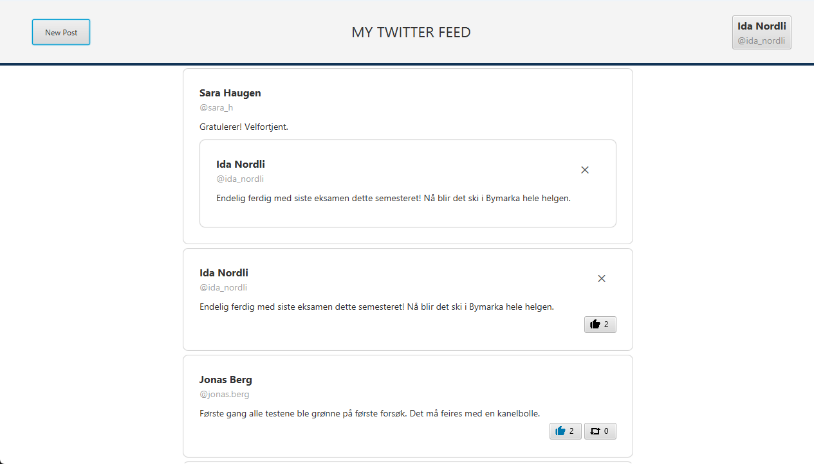

# Twitter Clone

A Twitter-style desktop app with a JavaFX client and a Spring Boot REST API. Users can log in, write posts, like and retweet, and view profiles.

Group project in IT1901 Informatics, Project I at NTNU, fall 2025 (5 students).

Java 17 · JavaFX · Spring Boot · REST · JWT · Hibernate · Maven · JUnit · Mockito · JaCoCo · SpotBugs · Checkstyle



*The screenshot shows test data.*

## Architecture

The project is split into Maven modules:

| Module | Responsibility |
|---|---|
| `core` | Domain classes (users, posts) |
| `persistence` | Storage, both JSON files and a database through Hibernate |
| `service` | Client-side services, including the HTTP client for the REST API |
| `api` | Spring Boot REST API with JWT authentication |
| `ui` | JavaFX client |

## My contribution

- Wrote unit tests with Mockito for the service and persistence modules, including `PostServiceTest`, `UserServiceTest` and the tests for the JSON and ORM repositories.
- Took part in implementing the REST endpoints in `UserController` and `PostController`.
- Cleaned up parts of the code base and made sure all modules had consistent JavaDoc.
- Wrote documentation and took part in code reviews.

## Project Dependencies

We assume you have installed:

- Java 17 or above
- The latest version of Maven 3.9.x

All other dependencies are described in the different `pom.xml` files and shall be installed automatically by Maven.

## Getting Started

### Module installation

Make sure you have installed the required dependencies listed above.

The commands listed below assume your current working directory is `twitter-clone`.
To change your working directory, run `cd twitter-clone` when you are in the project root.

First, you must install all the modules. You will need to skip all tests, because the tests require a REST API running the background.

Use the following command:

```sh
mvn clean install -DskipTests -Dcheckstyle.skip -Dspotbugs.skip -Djacoco.skip -T 1C
```

<details>

<summary>Using PowerShell?</summary>

Then you'll need to wrap the parameters in quotation marks:

```sh
mvn clean install "-DskipTests" "-Dcheckstyle.skip" "-Dspotbugs.skip" "-Djacoco.skip" -T 1C
```

</details>

### REST API setup

The API depends on a secret key to generate authentication tokens, and this secret is not commited to version control.

Generate the `jwtSecret` for the API module:

Copy the file `api/src/main/resources/application.properties.example` to `api/src/main/resources/application.properties`.

The example file contains placeholder secrets.

Run the following command (from `twitter-clone`):

```sh
mvn -q -pl api exec:java -Dexec.mainClass="api.utils.JwtKeyGenerator"
```

Override the example secret with the generated value.

### Running the app

> [!NOTE]
> The client requires the REST API to be running on `localhost:8080`

Start the api:

```sh
cd api
mvn spring-boot:run
```

Start the client:

```sh
cd ui
mvn javafx:run
```

### Testing the app

Start the api if you're running ui integration tests:

```sh
cd api
mvn spring-boot:run
```

Run the tests:

```sh
mvn test
```

The tests can also be run in your favorite IDE. We have tested that everything works in VS Code.

If you would like to see the JaCoCo code coverage and spotbugs reports, use the following command:

```sh
mvn verify
```

You can read the SpotBugs report by opening `twitter-clone/<module>/target/site/spotbugs.html` and you can read the JaCoCo report by opening `twitter-clone/<module>/target/site/jacoco/index.html`.
The `<module>` must be replaced with the module name, without the angle brackets.

### Building the app

First, please make sure to install all modules as explained in [Module installation](#module-installation).

You can build and create a shippable executable of the app for your platform by using the following command:

```sh
cd ui
mvn jpackage:jpackage
```

<details>

<summary>Using or building for Windows?</summary>

You must install the [WiX Toolset](https://github.com/wixtoolset/wix3) when building for Windows.

Because we use Java 17, we must use the latest version of WiX 3.x.
This WiX version is deprecated, and should be upgraded as soon as the project can move beyond Java 17.

</details>

<details>
<summary>Course documentation (release 1–3)</summary>


### Release 1

- [Release 1 docs](./docs/release1/README.md)
- [Project description](./docs/release1/project-description.md)
- [Usage of AI tools](./docs/release1/ai-tools.md)

### Release 2

- [Release 2 docs](./docs/release2/README.md)
- [Usage of AI tools](./docs/release2/ai-tools.md)
- [Code quality](./docs/release2/code-quality.md)
- [Persistence](./docs/release2/persistence.md)
- [Teamwork](./docs/release2/teamwork.md)
- [Work practices](./docs/release2/work-practices.md)
- [Workflow](./docs/release2/workflow.md)
- [Package diagram](./docs/release2/package-diagram.puml)
- [Class diagram](./docs/release2/class-diagram.puml)

### Release 3

- [Release 3 docs](./docs/release3/README.md)
- [Project description](./docs/release3/project-description.md)
- [Contribution](./docs/release3/contribution.md)
- [Usage of AI tools](./docs/release3/ai-tools.md)
- [Challenges](./docs/release3/challenges.md)
- [REST service](./docs/release3/rest-service.md)
- [Teamwork](./docs/release3/teamwork.md)
- [Sustainability](./docs/release3/sustainability.md)
- [Sustainability table](./docs/release3/sustainability-table.md)
- [Sustainability SusAD diagram](./docs/release3/sustainability-susad-diagram.png)
- [Package diagram](./docs/release3/package-diagram.puml)
- [Core class diagram](./docs/release3/core-class-diagram.puml)
- [UI and services class diagram](./docs/release3/ui-class-diagram.puml)
- [Sequence diagram](./docs/release3/sequence-diagram.puml)

</details>

## Diagrams

<details>

<summary>UI and services class diagram</summary>


</details>

<details>

<summary>Core class diagram</summary>


</details>

<details>

<summary>Package diagram</summary>


</details>

<details>

<summary>Sequence diagram</summary>


</details>

<details>

<summary>Sustainability SusAD diagram</summary>


</details>
